# 🏛️ Nagrik AI: System Architecture & Technical Specifications

> **System Overview**: High-concurrency, multilingual municipal intelligence platform designed for municipal corporations, smart cities, and urban local bodies (ULBs). Integrates Hybrid Vector RAG, Devanagari Cross-Script Normalization, Statutory Reranking, Multi-Tier Resilient LLM Streaming, Autonomous Grievance Triage, and Executive Decision Support.

---

## 1. High-Level Component Topology

```mermaid
flowchart TB
    subgraph CitizenLayer ["1. Citizen Engagement Tier (Vercel Edge)"]
        Sidebar["Gemini Conversation Sidebar (Max 20 Chats, FIFO Auto-Pruning)"]
        VoiceIn["Voice Input (Browser Web Speech / Whisper API)"]
        TextIn["Multilingual Text Chat (EN, HI, MR, TA, etc.)"]
        AudioOut["Studio Voice Output (Edge Neural TTS / Chunked WebSpeech)"]
        HUD["Living Ward Profile HUD (GPS Haversine Auto-Detection)"]
        Palette["Civic Command Palette (Cmd+K)"]
        Sidebar & VoiceIn & TextIn & AudioOut & HUD & Palette
    end

    subgraph IngressLayer ["2. Ingress & Security Boundary (FastAPI Gateway)"]
        CORS["Strict CORS Regex (Vercel & Municipal Domains)"]
        RateLimiter["Sliding-Window Rate Limiter (15 RPM, 10K IPs Bounded Memory)"]
        JailbreakFilter["Jailbreak & Prompt-Injection Deterministic Filter (<1ms)"]
        AuthFilter["Supabase Asymmetric JWKS (RS256) JWT Verifier"]
        StreamUpload["Chunked Streaming Upload Shield (64KB chunks, max 10MB)"]
        RateLimiter --> JailbreakFilter --> AuthFilter
    end

    subgraph DeterministicLayer ["3. Deterministic Pre-Gates (<5ms, Zero LLM)"]
        SOSGate{"Emergency SOS Gate<br/>(Fire 101, Police 100, Med 108)"}
        ScopeGate{"Municipal Scope Gate<br/>(Rejects non-civic queries)"}
        IntentGate{"Conversational Intent Gate<br/>(Greetings, Identity)"}
        ParamGate{"Completeness Gate<br/>(Checks Ward, Assessment ID)"}
        
        AuthFilter --> SOSGate
        SOSGate -->|Emergency| SOSDispatch["Instant SOS Banner + Helpline Numbers"]
        SOSGate -->|Normal| ScopeGate
        ScopeGate -->|Out of Scope| ScopeRefusal["Polite Municipal Guidance (<5ms)"]
        ScopeGate -->|In Scope| IntentGate
        IntentGate -->|Small Talk| WarmReply["Instant Warm Greeting (citations: [])"]
        IntentGate -->|Service Query| ParamGate
    end

    subgraph KnowledgeLayer ["4. Hybrid Knowledge Layer & Dedicated Reranker"]
        DevanagariBridge["Devanagari Statutory Normalizer (Cross-Script Bridge)"]
        DenseModel["FastEmbed ONNX (all-MiniLM-L6-v2, 384d Dense)"]
        SparseModel["FastEmbed BM25 (Qdrant/bm25 Lexical)"]
        QdrantRRF["Qdrant Cloud: municipal_knowledge<br/>Server-Side Reciprocal Rank Fusion (Top 8)"]
        CivicReranker["Civic Statutory Reranker (Top 8 → Top 5 High-Density Chunks)"]
        
        ParamGate --> DevanagariBridge --> DenseModel & SparseModel
        DenseModel & SparseModel --> QdrantRRF --> CivicReranker
    end

    subgraph GenerationLayer ["5. 3-Tier Resilient Generation Pipeline"]
        PromptScaffold["Causal Reasoning Civic Prompt Scaffold (Rule 1-7)"]
        GeminiFlash["Tier 1: Gemini 3.7 Flash (Primary, 600ms Retry)"]
        GeminiLite["Tier 2: Gemini 3.5 Flash-Lite (Surge Escalation)"]
        GroqLlama["Tier 3: Groq Llama 3.3 70B (Emergency Failover)"]
        
        CivicReranker --> PromptScaffold --> GeminiFlash
        GeminiFlash -.503 Surge.-> GeminiLite -.Timeout.-> GroqLlama
    end

    subgraph PostStreamLayer ["6. Audit, Escalation & Observability"]
        CitationPruner["Post-Stream Regex Auditor (filter_cited_evidence)"]
        EscalationTriage{"Grievance or Unresolved?"}
        TicketEngine["Department Escalation Engine<br/>Hash: MCGM-2026-WXX-DEPT-XXXX"]
        PostgresDB[(Supabase PostgreSQL / SQLite WAL)]
        LangfuseTracer["Langfuse Async Telemetry (Non-blocking)"]
        
        GeminiFlash & GeminiLite & GroqLlama --> CitationPruner
        CitationPruner --> EscalationTriage
        EscalationTriage -->|Yes| TicketEngine --> PostgresDB
        EscalationTriage -->|No| CitizenLayer
        TicketEngine --> CitizenLayer
        CitationPruner -.Async.-> LangfuseTracer
    end

    subgraph KeepAliveLayer ["7. High-Availability Keep-Alive Engine"]
        CronJob["cron-job.org (Every 14 Mins)"]
        KeepAliveRoute["/api/v1/keep-alive"]
        RenderKeep["Render Container Awake"]
        SupabaseReset["Supabase 7-Day Inactivity Timer Reset"]
        QdrantReset["Qdrant Cluster Dormancy Reset"]
        
        CronJob --> KeepAliveRoute --> RenderKeep & SupabaseReset & QdrantReset
    end
```

---

## 2. End-to-End Request Lifecycle & Latency Budget

| Pipeline Stage | Module / Component | Latency | Fallback Mechanism |
| :--- | :--- | :--- | :--- |
| **1. Ingress & Rate Limiting** | `middleware.py` | `< 1 ms` | HTTP 429 after 15 RPM per client IP |
| **2. Security & Jailbreak Pre-Gate** | `scope_gate.py` | `< 2 ms` | Deterministic prompt injection rejection |
| **3. Emergency SOS Filter** | `emergency_sos.py` | `< 2 ms` | Instant emergency hotlines (101, 100, 108) |
| **4. Devanagari Normalization** | `normalizer.py` | `< 3 ms` | Cross-script statutory token enrichment |
| **5. Hybrid Dense + Sparse RRF** | `hybrid_search.py` (Qdrant Cloud) | `15 - 35 ms` | In-memory local SQLite / Qdrant fallback |
| **6. Statutory Reranking** | `reranker.py` (`CivicReranker`) | `< 5 ms` | Initial RRF candidate ordering |
| **7. Multi-Tier LLM Token Stream** | `llm_client.py` (Gemini 3.7 Flash) | `300 - 800 ms TTFT` | Auto-cascades to Gemini 3.5 Lite, then Groq Llama 3.3 |
| **8. Post-Stream Citation Pruning**| `pruner.py` | `< 2 ms` | Enforces `citations: []` if not cited via `[Sx]` |
| **9. Autonomous Grievance Triage** | `triage.py` | `< 5 ms` | Generates official tracking docket & receipt |

---

## 3. NLP Architecture & Technical Innovations

### 3.1 Server-Side Reciprocal Rank Fusion (RRF)
Civic queries contain both colloquial phrasing (*"brown dirty water coming from tap"*) and statutory codes (*"Circular 492/B"*, *"Form 3A"*, *"Section 128(1)(a)"*). Nagrik AI fuses dense semantic and sparse lexical vectors natively within Qdrant Cloud:
$$\text{RRF\_Score}(d) = \sum_{m \in \{\text{dense}, \text{sparse}\}} \frac{1}{60 + \text{rank}_m(d)}$$

### 3.2 Civic Reranker Stage (`CivicReranker`)
Before passing candidates to the LLM, a dedicated reranker scores candidates across:
* **Statutory Density**: Prioritizing formal gazette sections (e.g. OBPAS setbacks, water tariffs, penalty schedules).
* **Cross-Script Relevance**: Ensuring Marathi/Hindi queries match relevant English statutory sections.
* Reranks **top 8 candidates down to the top 5 highest-density chunks**, maximizing context efficiency on the 512MB RAM server.

### 3.3 Multi-Tier Generation Resiliency
* **Tier 1 (Primary)**: `gemini-3.7-flash` with 1-attempt 600ms exponential backoff on transient 503 high-demand surges.
* **Tier 2 (Secondary)**: `gemini-3.5-flash-lite` for instantaneous failover if Tier 1 experiences extended spikes.
* **Tier 3 (Tertiary)**: `llama-3.3-70b-versatile` via Groq for complete provider redundancy.

### 3.4 Continuous Sentence-Chunked Speech Synthesis
* **Primary TTS**: Microsoft Edge Neural TTS (`hi-IN-SwaraNeural`, `mr-IN-AarohiNeural`, `en-IN-NeerjaNeural`).
* **Web Speech API Fallback**: Chunks responses by sentence (`.`, `?`, `!`, `।`), queueing utterances sequentially to eliminate Chrome's 15-second speech synthesis garbage collection cutoff bug.
* **Full Audio Control**: User toggleable auto-play, active playback wave indicator, and instant Pause/Stop controls.

---

## 4. High-Availability Keep-Alive Engine (`/api/v1/keep-alive`)

To prevent cold starts and auto-suspensions across free-tier infrastructure, a unified keep-alive endpoint resets inactivity timers:
1. **Render Worker**: Keeps Linux container, Uvicorn, and FastEmbed ONNX pre-warmed.
2. **Supabase PostgreSQL**: Executes a 1-row fetch (`wards.select('id').limit(1)`), resetting Supabase's **7-day inactivity pause counter**.
3. **Qdrant Cloud**: Calls `get_collections()` on the vector client, resetting the **dormancy suspension timer**.

**Automated Ping**: Configured via [cron-job.org](https://cron-job.org/) to hit `https://nagrik-ai-wvuw.onrender.com/api/v1/keep-alive` every 14 minutes.

---

## 5. Security & Multi-Tenant Isolation Specifications
1. **Prompt Injection / Jailbreak Filter**: Deterministic regex pre-gate rejects adversarial override instructions prior to LLM invocation.
2. **Path Traversal Protection**: Enforces `is_relative_to(corpus_dir)` check on all document downloads.
3. **Memory Safety**: Direct streaming to disk in 64KB chunks bounded by `asyncio.Semaphore(2)` and 10MB file ceiling for Render 512MB RAM survival.
4. **Rate Limiting**: Bounded sliding window (15 RPM, 10,000 max IPs) with automatic TTL pruning.
5. **Database Concurrency**: SQLite initialized with `PRAGMA journal_mode=WAL;` and `PRAGMA busy_timeout=5000;` to prevent write lock contention.
